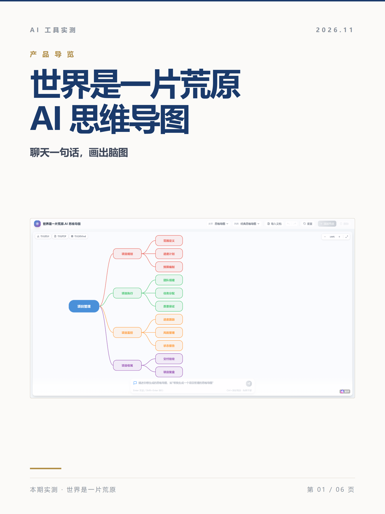
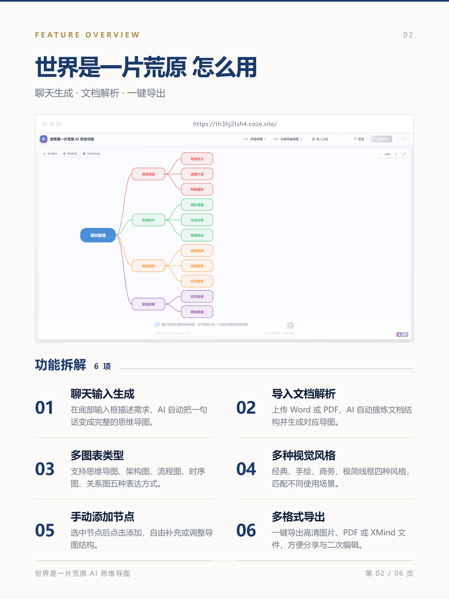
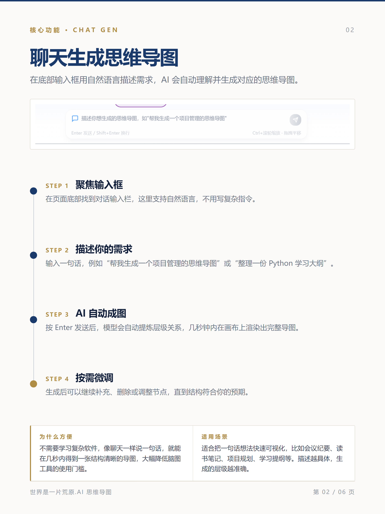
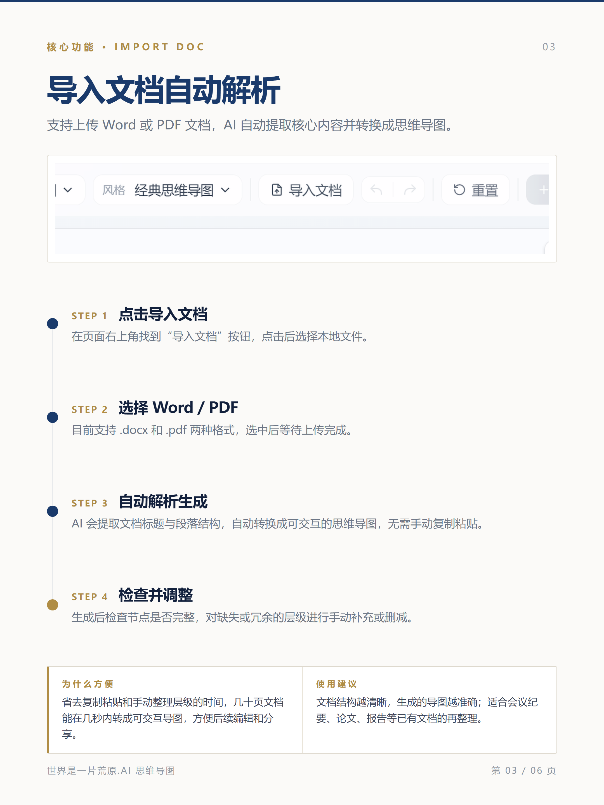
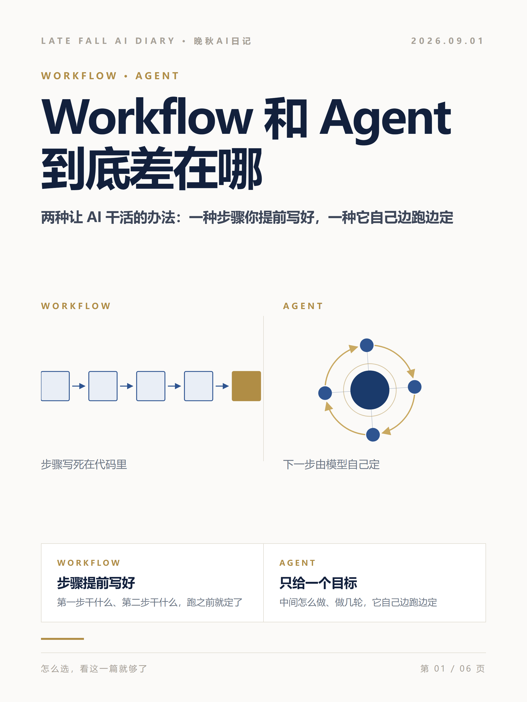
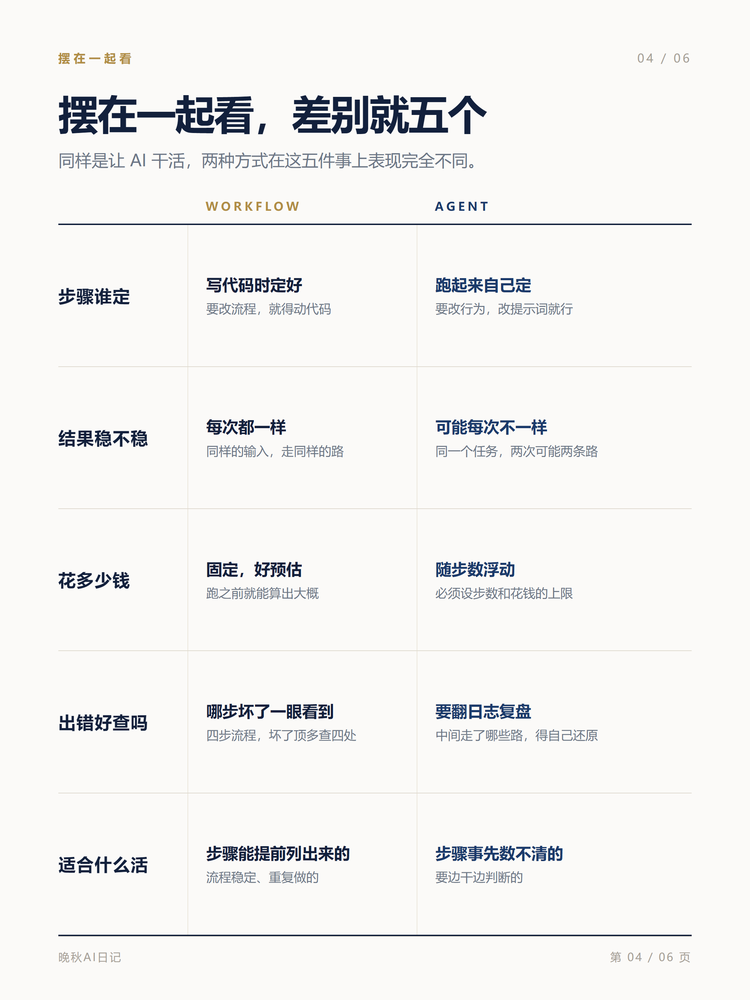
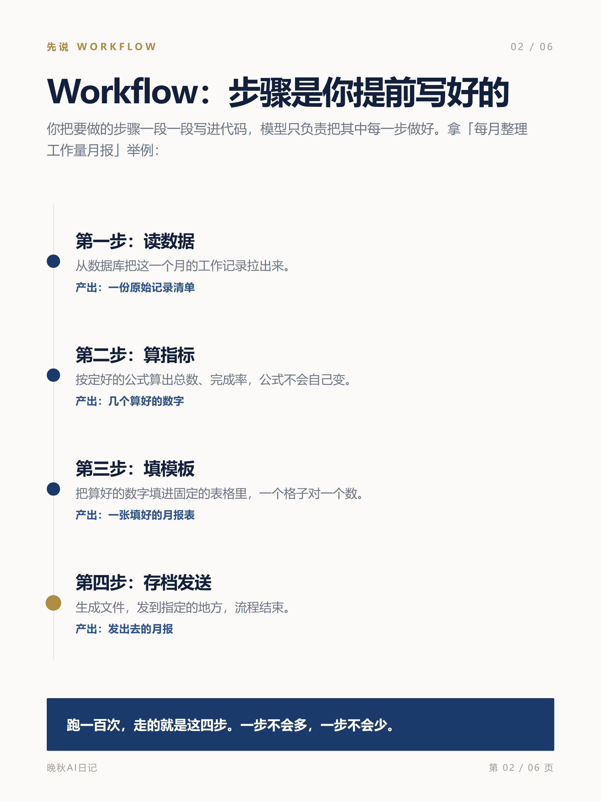
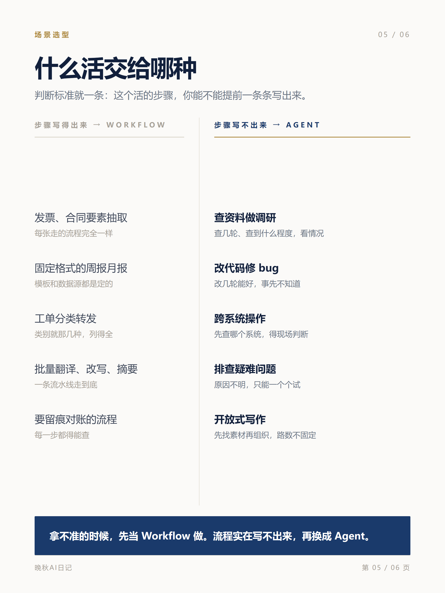
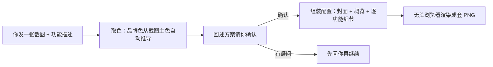
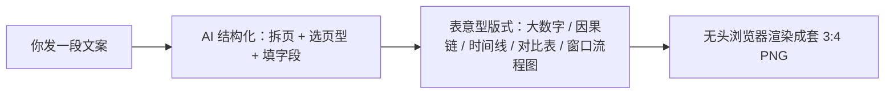

# 📸 截图教程图 & 信息图 配图生成器 · Screenshot & Text → Infographic Generator

> **一句话看懂**：你发 **一张截图**，或 **一段文字**，"它"就帮你自动生成一整套能在小红书 / 公众号 / 社群直接发的「功能教程图 / 信息图」。不用会排版、不用会 PS、不用写代码。

> **EN**: An AI skill that turns *one screenshot* or *a paragraph of text* into a complete set of on-brand tutorial / infographic images — ready to post on Xiaohongshu, WeChat, or any community. No design or coding needed.
> 🇺🇸 Full English docs: [README_EN.md](README_EN.md)

[](LICENSE)
[](requirements.txt)
[](CHANGELOG.md)


> 🔖 **搜索关键词**：截图生成教程图 · 功能讲解图 · 产品导览图 · 小红书配图 · 信息图 · infographic generator · screenshot tutorial · text to infographic · Claude Code skill · Codex skill · WorkBuddy skill · 跨平台 skill

---

## 📑 目录

- [它能帮你解决什么](#-它能帮你解决什么)
- [效果预览（直接看图）](#-效果预览直接看图)
- [两种用法](#-两种用法)
- [安装（一步步来）](#-安装一步步来)
- [支持哪些 AI 客户端（跨平台通用）](#-支持哪些-ai-客户端跨平台通用)
- [怎么用（核心是"对 AI 说一句话"）](#-怎么用核心是对-ai-说一句话)
- [工作原理（技术向，可跳过）](#-工作原理技术向可跳过)
- [目录结构](#-目录结构)
- [环境要求与跨平台注意事项](#-环境要求与跨平台注意事项)
- [常见问题 FAQ](#-常见问题-faq)
- [贡献 / 许可证 / 更新日志](#-贡献--许可证--更新日志)

---

## 💡 它能帮你解决什么

做产品教程图 / 科普配图，最烦的是这几件事：

- **耗时**：一张一张截、裁、排版、配色，半天就过去了。
- **风格不统一**：每次做的颜色、圆角、字体都不一样，发出去像拼凑的。
- **不会排版**：想做得像小红书上那种「干净、高级、信息密度高」的图，但自己搞不定。
- **要反复确认**：怕裁错区域、怕泄露隐私信息。

这个技能把上面全包了：

| 你只要做 | 它会给你 |
|---|---|
| 发一张截图 + 一段功能描述 | 1 张封面 + 1 张概览 + 若干张单功能细节图 |
| 发一段文字（主题或文案） | 1 张封面 + 若干内容页信息图 |

全部成图统一为 **1080×1440 竖版 3:4 高清 PNG**（2× 渲染为 2160×2880），带统一页脚与页码，发出去不用二次加工。而且**出图前会先跟你确认方案**，不乱裁、不泄露。

视觉风格为「晚秋简约」：单一品牌色（截图模式从截图主色自动推导；文案模式默认深蓝 `#1A3A6B`）+ 哑光金小面积强调 + 暖白背景 + 1px 细线分隔——没有彩虹功能色卡片、没有渐变徽章、没有重投影、没有 3D 插画，**纯排版、离线可跑**。

---

## 🖼️ 效果预览（直接看图）

**① 截图模式** —— 下面这套基于「世界是一片荒原.AI 思维导图」的真实截图生成，品牌色从截图主色自动推导：

| 封面 · 独立传播用 | 第 1 张 · 总体概览 |
|---|---|
|  |  |

| 第 2 张 · 单个功能细节 | 第 3 张 · 单个功能细节 |
|---|---|
|  |  |

**② 纯文案模式** —— 你只给一个主题（这里以「Workflow 和 Agent 的区别」为例），AI 自动结构化 + 表意型排版（视觉元素直接编码内容：竖链=因果、对比表=差异、SVG 示意图封面）：

| 封面（SVG 示意图编码内容） | 双栏对比表 |
|---|---|
|  |  |
|  |  |

---

## 🚀 两种用法

### 方式一：截图 → 功能教程图

**你发给 AI 的**：一张产品截图 + 一段功能描述。
**AI 还给你的**：1 张极简传播封面 + 1 张总体概览（功能表格化拆解）+ 若干张单功能细节页（自动裁出对应区域、局部放大）。

适合：软件/网站/小程序/后台系统的功能介绍、上手教程。

### 方式二：纯文字 → 信息图

**你发给 AI 的**：一段主题文案（比如"帮我做 5 张关于 XX 的科普配图"）。
**AI 还给你的**：1 张封面 + 若干内容页。纯排版零插画、零外部服务依赖，**离线可跑**。页面类型覆盖：大数字页、竖向因果链、纵向时间线、双栏对比、逐行对比表、窗口流程图（终端窗口 + 连接线 + 概率条 + 选项块）、收尾判断页。

适合：知识科普、名词解释、活动预告、资讯解读——**手头没有现成截图也能做**。

---

## 📦 安装（一步步来）

### 你需要先准备什么（前置条件）

1. **Python 3.10 或以上**（不确定版本？终端里敲 `python --version` 看一眼）。
2. **一台带浏览器的电脑**，用于把排版渲染成图片：
   - Windows → 需要 Microsoft Edge
   - macOS → 需要 Chrome
   - Linux → 需要 Chromium

就这两样。所有依赖只剩一个 Pillow（安装脚本自动装）。

### 方法 A：让 AI 帮你装（最省事，推荐）

如果你用的是支持「技能（Skill）」的 AI 客户端（Claude Code / Codex / WorkBuddy 都支持），直接对它说：

> 帮我把这个 GitHub 仓库克隆到我的技能目录并安装依赖：
> `https://github.com/Wanqiu12345/screenshot-infographic-skill`
> 克隆完成后运行里面的 `install.py`。

AI 会自动完成：克隆 → 放进对应技能目录（Claude Code 用 `~/.claude/skills/`、Codex 用 `~/.agents/skills/`、WorkBuddy 用 `~/.workbuddy/skills/`）→ 运行 `python install.py` 装好依赖并检测浏览器。装完就能在对话里直接用。

### 方法 B：自己手动装（命令行）

```bash
# 1) 把仓库下载到本地
git clone https://github.com/Wanqiu12345/screenshot-infographic-skill.git
cd screenshot-infographic-skill

# 2) 一键安装：创建隔离环境 + 装依赖 + 检测浏览器
python install.py

# 3) 装好后，把整个文件夹复制到你的技能目录：
#    Windows: C:\Users\<你的用户名>\.workbuddy\skills\   （WorkBuddy）
#    macOS/Linux: ~/.workbuddy/skills/                      （WorkBuddy）
#    跨平台：Claude Code → ~/.claude/skills/    Codex → ~/.agents/skills/
```

> 💡 装完之后，你**不需要再碰命令行**。日常使用就是在对话里发截图 / 发文字，让 AI 调用这个技能就行。

### 怎么确认装好了？

跑一句验证（不需要任何输入，用自带的示例）：

```bash
# 文案模式演示：自动渲染 examples/wf_agent_v2.json 到 output_text/
python run_text_tutorial.py

# 截图模式演示：自动用 examples/screenshot.png 渲染到 output/
python run_screenshot_tutorial.py
```

如果输出目录里出现 `00_cover.png` 等一整套 PNG，说明安装成功 ✅。

---

## 🌐 支持哪些 AI 客户端（跨平台通用）

本技能遵循 **Agent Skills 开放标准（agentskills.io）**，技能目录结构（一个 `SKILL.md` + 可选 `scripts/`、`assets/`）在主流编码智能体之间**通用**，无需改写：

| 客户端 | 技能目录 | 状态 |
|---|---|---|
| **Claude Code** | `~/.claude/skills/` | ✅ 原生支持 |
| **OpenAI Codex** | `~/.agents/skills/`（或仓库内 `.agents/skills/`） | ✅ 原生支持 |
| **WorkBuddy** | `~/.workbuddy/skills/` | ✅ 原生支持 |

> 技能里的 Python 脚本靠终端执行，上述工具都具备终端 / 代码执行能力，所以**脚本直接跑、不用改**。
> 展示成图时：WorkBuddy 用 `present_files` 一次性预览；其他工具直接打开生成的输出目录里的 `*.png` 文件即可。

---

## 🎯 怎么用（核心是"对 AI 说一句话"）

最常用、最推荐的方式就是**在对话里直接说**。下面这些话可以直接复制粘贴给你的 AI 助手（前提是对方装了本技能）。

### 场景一：你有一张截图，想做功能教程图

> 用 `screenshot-infographic-skill` 技能，根据这张截图给我做一套功能教程图。
> 功能包括：聊天生成导图、导入文档解析、图表类型切换、多格式导出。
> 品牌名：你的产品名，网址：https://你的产品网址/

把你的截图**拖进对话框**，再补一句功能描述即可。技能会**先回述方案让你确认，再出图**，不会乱裁。
截图模式的品牌名 / 网址通过环境变量传给脚本（`BRAND_NAME` / `BRAND_URL` / `BRAND_SUBTITLE` / `BRAND_CATEGORY` / `SCREENSHOT`），AI 会自动处理。

### 场景二：你只有一段文字，想做主题配图

> 用 `screenshot-infographic-skill` 技能，根据下面这个主题给我做一套科普配图。
> 主题：「Jev 模型是什么：它跟大模型的区别」。
> 文案如下：
> 【把你的文案贴在这里，或只给主题也行】

该模式会自动：把内容结构化成多页配置（拆页 + 选页型 + 填字段）→ 表意型排版 → 无头浏览器渲染成套 PNG。

### 命令行用法（进阶 / 批量自动化）

```bash
# 纯文案模式：把结构化配置渲染成套图（字段规范见 SKILL.md）
python run_text_tutorial.py my_config.json --out my_output_dir
# 只渲染某一页（调试用，按页面 name 或文件名匹配）：
python run_text_tutorial.py my_config.json --out my_output_dir --only 03_机制差别
# 无参数则跑内置演示（examples/wf_agent_v2.json）：
python run_text_tutorial.py

# 截图模式：默认用仓库自带示例截图，输出到 output/
python run_screenshot_tutorial.py
# 用你自己的截图（品牌信息用环境变量覆盖）：
#   Windows
set SCREENSHOT=D:/path/to/your.png
set BRAND_NAME=你的产品名
python run_screenshot_tutorial.py
#   macOS / Linux
SCREENSHOT=/path/to/your.png BRAND_NAME=你的产品名 python run_screenshot_tutorial.py
```

### 关于「确认门」（为什么它不会乱出图）

出图前，技能会把下面这些**先念给你听、等你点头**：

- 拆几页、每页用什么版式
- 标题与文案方向
- 每张细节图对应截图里的**哪个区域**（截图模式）
- 品牌页脚写什么

如果你描述的功能名称不确切、或截图定位不准，它会**先问你**再继续。一句话：**宁可多问，不出错图。**

---

## 🔧 工作原理（技术向，可跳过）

截图模式整体流水线：



纯文案模式整体流水线：



底层关键技术点：

- **品牌色自动推导**（截图模式）：截图主色 HSV 降饱和压暗成单一品牌色，金色 `#B08D45` 只做小面积强调，深浅主题随截图自动判定。
- **表意型排版**（文案模式）：视觉元素直接编码内容，每页 `flex:1` 撑满 1080×1440 不留大片空白。
- **无头渲染环境隔离**：渲染时强制传最小环境变量（SAFE_ENV），规避宿主注入的 `NODE_OPTIONS` 等变量导致 Edge / Chrome 无头模式秒退。
- **保留可编辑 HTML**：每张成图同时保留 HTML 源文件（输出目录 `_html/` 下），方便二次修改后重渲染。

---

## 📁 目录结构

```text
screenshot-infographic-skill/
├── SKILL.md                      # 主指令（AI 客户端触发用，含配置字段规范）
├── README.md                     # 本文件
├── LICENSE                       # MIT 许可证
├── CHANGELOG.md                  # 版本更新记录
├── CONTRIBUTING.md               # 贡献指南（给开发者）
├── requirements.txt              # Python 依赖（仅 Pillow）
├── install.py                    # 一键安装脚本
├── run_screenshot_tutorial.py    # 截图模式：命令行入口
├── run_text_tutorial.py          # 纯文案模式：命令行入口
├── scripts/
│   ├── text_v2.py                # 纯文案模式渲染器（表意型排版，7 种页型）
│   ├── screenshot_v2.py          # 截图模式渲染器（晚秋简约风）
│   ├── render.py                 # 无头浏览器渲染 PNG（含 SAFE_ENV 环境隔离）
│   ├── social_post.py            # 随图附赠小红书发布文案
│   └── package_skill.py          # 打包分发 zip
├── assets/                       # README 封面图
└── examples/
    ├── screenshot.png            # 示例截图（截图模式演示输入）
    ├── 00_cover.png … 05_*.png   # 截图模式示例输出
    ├── wf_agent_v2.json          # 纯文案模式示例配置（Workflow vs Agent 主题）
    └── wf_agent_v2_*.png         # 纯文案模式示例输出
```

---

## 🧰 环境要求与跨平台注意事项

这套技能是**纯 Python + 无头浏览器**，理论上任何装了 Python 的电脑都能跑。但有几个真实坑，提前说清楚能省你两小时：

### 1. 必须装一个 Chromium 内核浏览器（渲染依赖）
出图靠系统浏览器无头渲染，所以机器上**必须有 Edge / Chrome / Chromium 之一**（`render.py` 会自动查找）：

- **Windows**：装 Microsoft Edge 或 Chrome（通常已自带）。
- **macOS**：装 Chrome（或 Edge）。
- **Linux 服务器 / 容器（最常见踩坑点）**：大多数云服务器**默认没有**浏览器，需要手动装：
  ```bash
  # Debian / Ubuntu
  sudo apt-get update && sudo apt-get install -y chromium
  # RHEL / Fedora
  sudo dnf install -y chromium
  # Arch
  sudo pacman -S chromium
  ```
  容器环境（Docker、各类沙箱）里若无 `--no-sandbox` 会崩，本技能已在 `render.py` 内置该参数和 `--disable-dev-shm-usage`，一般可直接用。

> 没装浏览器时 `render.py` 会明确报错并给出上面的安装命令，不会静默出空图。

### 2. 无头渲染在特殊环境下秒退
宿主环境注入的 `NODE_OPTIONS` / `ELECTRON_RUN_AS_NODE` 等环境变量会让 Chromium 无头模式秒退。本技能已在 `render.py` 里做了**最小环境变量隔离（SAFE_ENV）**，正常直接跑即可；如果你自己二次开发绕过了 `render.py` 裸调浏览器，就会踩这个坑。

### 3. Python 虚拟环境（venv）
`install.py` 会在本目录建隔离 `.venv` 并装依赖。Linux 上若提示 `ensurepip` / `venv` 缺失，先装：
```bash
sudo apt-get install -y python3-venv python3-pip   # Debian/Ubuntu
```

### 4. 路径与权限
所有脚本都用**相对路径**（`__file__` 基准），复制到任意机器、任意目录都能跑，**没有写死作者本机路径**。输出默认落在技能目录下的 `output/`（截图模式）与 `output_text/`（文案模式），已加入 `.gitignore`，不会污染源码。

---

## ❓ 常见问题 FAQ

**Q：生成的图分辨率是多少？**
A：默认 1080×1440 竖版 3:4（2× 渲染为 2160×2880 高清）。适合小红书 / 公众号竖图。

**Q：配色能自己定吗？**
A：截图模式的品牌色从你的截图主色自动推导，不用手动指定色值；文案模式默认深蓝 `#1A3A6B` + 哑光金强调，可在配置 JSON 里用 `primary` 字段指定主色。

**Q：渲染出来的图有空白或错位？**
A：优先检查配置 JSON 的字段名——文案模式的时间线用 `nodes` 不是 `events`、因果链的 `steps` 是数组不是字典。字段规范全部在 `SKILL.md` 里。

**Q：什么是「确认门」？**
A：出图前技能会把拆页方案、每页版式、文案方向、页脚内容先念给你确认，宁可多问不出错图。如果你描述含糊或定位不准，它会先问你。

**Q：必须装浏览器吗？**
A：是的，渲染用系统无头浏览器（Windows=Edge / macOS=Chrome / Linux=Chromium）才能完整支持渐变、阴影、字体等效果，成图质量远高于纯拼图。`install.py` 会自动检测。

**Q：还需要联网 / 调用图片生成 API 吗？**
A：不需要。v2.0.0 起两种模式都是纯排版渲染，除了首次安装依赖，日常出图完全离线。

**Q：生成的图能商用吗？**
A：工具本身 MIT 开源，你生成的图归你，可自由商用。但请留意截图里是否含第三方敏感信息或版权内容。

**Q：命令行跑出来的图在哪？**
A：截图模式在 `output/`，纯文案模式在 `output_text/`（或你 `--out` 指定的目录；这两个默认目录已加入 `.gitignore`，不会污染源码）。

---

## 🤝 贡献 / 许可证 / 更新日志

- **想一起完善？** 欢迎提 Issue 和 PR，请看 [CONTRIBUTING.md](CONTRIBUTING.md)。
- **许可证**：MIT，详见 [LICENSE](LICENSE)。
- **更新记录**：版本与改动明细见 [CHANGELOG.md](CHANGELOG.md)。

---

Made for people who hate making tutorial screenshots by hand. 🙌
